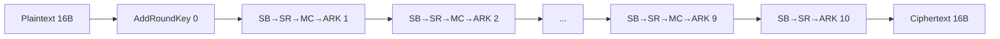

<div align="center">
  
# 🔐 AES‑128 en AArch64 (Software Puro)

**ARQUITECTURA DE COMPUTADORES Y ENSAMBLADORES 1**  
_Implementación 100% en ensamblador AArch64, sin librerías. E/S por syscalls. Ejecución en QEMU._

[](#)
[](#)
[](#)
[](#)
[](LICENSE)

</div>

---

## 📋 Tabla de contenidos
- [✨ Resumen](#-resumen)
- [🧩 Características](#-características)
- [🚀 Arranque rápido](#-arranque-rápido)
- [🛠️ Compilación y ejecución](#️-compilación-y-ejecución)
- [📟 Uso](#-uso)
- [🔎 Verificación (KAT NIST)](#-verificación-kat-nist)
- [🧱 Estructura del proyecto](#-estructura-del-proyecto)
- [🧠 Diseño / Decisiones](#-diseño--decisiones)
- [🧪 Depuración](#-depuración)
- [📈 Roadmap](#-roadmap)
- [🤝 Contribuir](#-contribuir)
- [📜 Licencia](#-licencia)

## ✨ Resumen
Este repo contiene un cifrador **AES‑128** implementado **íntegramente en ensamblador AArch64**.  
No usa `libc` ni bibliotecas externas: toda la E/S se realiza con **syscalls**. Incluye **expansión de clave**, **10 rondas** y **trazas del estado** tras cada transformación para fines didácticos.

> **Objetivo**: comprender a bajo nivel la representación del _state_, `ShiftRows`, `MixColumns`, `SubBytes`, `AddRoundKey` y el _key schedule_.

## 🧩 Características
- 🔧 **AArch64 puro**: ensamblado con `aarch64-linux-gnu-as`, enlazado con `ld` (sin `-lc`).  
- 🧠 **State en column‑major** y presentación amigable por filas (4×4).  
- 🧪 **Trazas**: matrices del estado tras cada etapa (opcional mediante flag).  
- ⏱️ **Medición de tiempo** con `clock_gettime(CLOCK_MONOTONIC)`.  
- 🧰 **Makefile** con targets simples (`make`, `make run`, `make clean`).

## 🚀 Arranque rápido
```bash
# Clonar
git clone https://github.com/Jsue46/ACYE1-P2-2S-202201336.git
cd /home/kali/Documentos/Arqui 1/Proyecto2/ACYE1-P2-2S-202201336/aes_main.s

# Ensamblar y enlazar
aarch64-linux-gnu-as -g -march=armv8-a -o aes_main.o aes_main.s
aarch64-linux-gnu-ld -o aes aes_main.o

# Ejecutar con QEMU
qemu-aarch64 ./aes
```

> También puedes usar:  
> ```bash
> make        # compila
> make run    # compila y ejecuta
> make clean  # limpia artefactos
> ```

## 🛠️ Compilación y ejecución
Requisitos:
- `binutils-aarch64-linux-gnu` (o toolchain equivalente)
- `qemu-user` (`qemu-aarch64`)
- GNU Make (opcional, si usas Makefile)

## 📟 Uso
Al ejecutar verás un **menú interactivo**:
```
=== MENU AES-128 ===
1) Ingresar TEXTO (ASCII)
2) Ingresar CLAVE (32 HEX)
3) Ejecutar AES-128
4) Informacion
5) Salir
> 
```
- **1)** Introduce hasta 16 caracteres ASCII (se rellena con 0 si son menos).
- **2)** Introduce **32** dígitos hex (clave de 128 bits).
- **3)** Ejecuta el cifrado, imprime tiempos y matrices (si debug activo).
- **4)** Muestra info y **vector NIST** de referencia.
- **5)** Salir.

## 🔎 Verificación (KAT NIST)
Prueba con el vector estándar:
```
Key: 000102030405060708090A0B0C0D0E0F
PT : 00112233445566778899AABBCCDDEEFF
CT : 69C4E0D86A7B0430D8CDB78070B4C55A
```
> Si ingresas esa **Key** y ese **PT**, el programa debe producir exactamente ese **CT**.

## 🧱 Estructura del proyecto
```
.
├─ aes_main.s            # Código principal (syscalls, menú, primitivas AES, key schedule)
├─ constants.s           # Tablas S-Box, Rcon y constantes
├─ Makefile              # Tareas de build/ejecución
├─ README.md             # Este documento
└─ docs/
   └─ ├─ Informe técnico
      └─ Informe De Impacto
```

## 🧠 Diseño / Decisiones
- **Representación del estado**
  - **Column‑major**: `state[r,c] = in[4*c + r]`  
  - Impresión por filas (4×4) para legibilidad.
- **Rondas**
  - Ronda 0: `AddRoundKey`
  - Rondas 1–9: `SubBytes → ShiftRows → MixColumns → AddRoundKey`
  - Ronda 10: `SubBytes → ShiftRows → AddRoundKey`
- **Expansión de clave**
  - `RotWord` (ROR 8), `SubWord` (S‑Box), `Rcon` aplicado al MSB, 44 palabras (K0..K10).

### Diagrama (mermaid)


## 🧪 Depuración
- El flag interno `debug_on` controla si se imprimen matrices tras cada etapa.  
- Para “benchmark”, desactiva debug para eliminar el costo de I/O en consola.

> Tip: puedes agregar una opción de menú para **toggle** de `debug_on` si lo necesitas.

## 📈 Roadmap
- [ ] Opción de **autotest** con vector NIST.
- [ ] Modo **benchmark** con N repeticiones y estadísticos.
- [ ] Optimización (desenrollado, tablas T o NEON).
- [ ] Modos de operación (CBC/CTR/GCM) si el curso lo permite.

## 🤝 Contribuir
1. Crea un branch: `git checkout -b feat/lo-que-sea`  
2. Commit: `git commit -m "feat: agrega X"`  
3. Push: `git push origin feat/lo-que-sea`  
4. Abre un PR.

## 📜 Licencia
Distribuido bajo la **MIT License**. Consulta `LICENSE` para más detalles.

---

> _Universidad de San Carlos de Guatemala — 2025_
