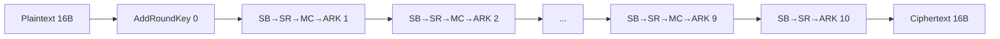

<div align="center">
  
# 🔐 AES-128 en AArch64 (Software Puro)

**ARQUITECTURA DE COMPUTADORES Y ENSAMBLADORES 1**  
_Implementación 100% en ensamblador AArch64, sin libc ni librerías. E/S por syscalls. Ejecución en QEMU._

[](#)
[](#)
[](#)
[](#)
[](LICENSE)

</div>

---

## 📋 Tabla de contenidos
- [✨ Resumen](#-resumen)
- [🧩 Características](#-características)
- [🚀 Arranque rápido](#-arranque-rápido)
- [🛠️ Requisitos / Build](#️-requisitos--build)
- [📟 Uso (menú)](#-uso-menú)
- [🧪 Verificación (KAT NIST)](#-verificación-kat-nist)
- [🧱 Estructura](#-estructura)
- [🧠 Diseño / Decisiones](#-diseño--decisiones)
- [🔍 Funciones clave del código](#-funciones-clave-del-código)
- [🐞 Depuración y tips](#-depuración-y-tips)
- [📏 Checklist de rúbrica (enunciado)](#-checklist-de-rúbrica-enunciado)
- [📈 Roadmap](#-roadmap)
- [🤝 Contribuir](#-contribuir)
- [📜 Licencia](#-licencia)

## ✨ Resumen
Cifrador **AES-128** implementado **íntegramente en ensamblador AArch64**.  
**Sin libc** ni librerías externas: toda la E/S se realiza vía **syscalls**. Incluye **expansión de clave**, **10 rondas**, **trazas por etapa** (SubBytes, ShiftRows, MixColumns, AddRoundKey), **criptograma** y **tiempo de ejecución** en milisegundos con 3 decimales.

> **Objetivo didáctico**: comprender a bajo nivel el _state_ (column-major), `SubBytes`, `ShiftRows`, `MixColumns`, `AddRoundKey` y el _key schedule_.

## 🧩 Características
- 🔧 **AArch64 puro**: `aarch64-linux-gnu-as` + `ld` (sin `-lc`).
- 🔢 **State en column-major**, impresión por filas (4×4) para legibilidad.
- 🧪 **Trazas por ronda**: imprime la matriz tras cada transformación.
- ⏱️ **Timing real** con `clock_gettime` (syscall 113) → ms con 3 decimales.
- 🧰 **Makefile** (`make`, `make run`, `make clean`) y menú interactivo.

## 🚀 Arranque rápido
```bash
# Clonar
git clone https://github.com/Jsue46/ACYE1-P2-2S-202201336.git
cd ACYE1-P2-2S-202201336

# Compilar y enlazar (sin libc)
aarch64-linux-gnu-as -g -march=armv8-a -o aes_main.o aes_main.s
aarch64-linux-gnu-ld -o aes aes_main.o

# Ejecutar con QEMU
qemu-aarch64 ./aes
```

> O usa Make:
> ```bash
> make        # compila
> make run    # compila y ejecuta
> make clean  # limpia artefactos
> ```

## 🛠️ Requisitos / Build
- `binutils-aarch64-linux-gnu`
- `qemu-user` (binario `qemu-aarch64`)
- GNU Make (opcional)

## 📟 Uso (menú)
```
=== MENU AES-128 ===
1) Ingresar TEXTO (ASCII)
2) Ingresar CLAVE (32 HEX)
3) Ejecutar AES-128
4) Informacion
5) Salir
> 
```
- **1)** Texto ASCII (hasta 16 chars; se _paddea_ con 0 si son menos).
- **2)** Clave **hex de 32 dígitos** (128 bits). Valida y convierte a bytes.
- **3)** Ejecuta AES-128 completo (10 rondas), imprime **trazas**, **criptograma** y **tiempo**.
- **4)** Muestra **info** + **vector NIST** de referencia.
- **5)** Salida.

### 🖨️ Ejemplo de sesión (real, recortado)
```
> 1
Ingrese el texto a cifrar (maximo 16 caracteres): Hoy llueve mucho
Matriz de Estado:
48 6C 76 75 
6F 6C 65 63 
79 75 20 68 
20 65 6D 6F 

> 2
Ingrese la clave (32 caracteres hex): 0123456789ABCDEF0123456789ABCDEF
Matriz de Clave:
01 89 01 89 
23 AB 23 AB 
45 CD 45 CD 
67 EF 67 EF 

> 3
Ejecutando AES-128...

=== RONDA 1 ===
Despues de SubBytes:
Matriz de Estado:
3B D9 F5 B0 
...
=== CRIPTOGRAMA FINAL ===
Matriz de Estado:
62 46 42 C4 
83 D0 08 ED 
DF 04 66 C9 
F9 A6 25 C0 

Texto cifrado: (ASCII crudo o HEX, según función usada)
Tiempo de ejecucion: 6.xxx ms
Listo.
```

> 🔎 **Nota**: El criptograma puede contener bytes no imprimibles. Para ver **HEX continuo**, usa la función `print_cipher_text` (incluida). Para ver caracteres directos, `print_cipher_text_ascii`.

## 🔎 Verificación (KAT NIST)
Prueba con el vector estándar:
```
Key: 000102030405060708090A0B0C0D0E0F
PT : 00112233445566778899AABBCCDDEEFF
CT : 69C4E0D86A7B0430D8CDB78070B4C55A
```
> Ingresando esa **Key** y ese **PT**, el programa debe producir exactamente ese **CT**.

## 🧱 Estructura
```
.
├─ aes_main.s            # Código principal (syscalls, menú, AES, timing)
├─ constants.s           # S-Box, Rcon y constantes asociadas
├─ Makefile              # Tareas de build/ejecución
├─ README.md             # Este documento
└─ docs/
   ├─ Manual de Usuario
   └─ Manuel Técnico
```

## 🧠 Diseño / Decisiones
- **Representación del estado**
  - **Column-major**: `state[r,c] = in[4*c + r]` (impresión 4×4 por filas).
- **Secuencia de rondas**
  - Ronda 0: `AddRoundKey`
  - Rondas 1–9: `SubBytes → ShiftRows → MixColumns → AddRoundKey`
  - Ronda 10: `SubBytes → ShiftRows → AddRoundKey`
- **Key Schedule**
  - 11 subclaves × 16 B = **176 B** (`expandedKey`).
  - `RotWord` (ROR 8), `SubWord` (S-Box) y `Rcon` en palabras múltiples de 4.
- **Tiempo de ejecución**
  - `clock_gettime` (syscall 113) → diferencia en **µs** → impresión como **ms.xxx**.

### Diagrama (mermaid)


## 🔍 Funciones clave del código
- **E/S (syscalls)**: macros `print`/`read` usando `write(64)`/`read(63)`.
- **Entrada de texto**: `readTextInput` → coloca bytes **column-major** con padding `0x00`.
- **Clave hex**: `convertHexKey` → ignora caracteres no hex, valida y convierte a bytes (column-major); mensaje de error si aplica.
- **AES Core**:
  - `subBytes`, `shiftRows`, `mixColumns` (con `xtime`, preservando callee-saved).
  - `addRoundKey` por ronda.
  - `keyExpansion` (44 palabras = 11×4B).
  - `aes_encrypt` (coordina 10 rondas y **trazas** por etapa).
- **Impresión**:
  - `printMatrix` (4×4 hex).
  - `print_hex_byte` / `_no_space` (para HEX continuo).
  - `print_cipher_text` (**HEX**) y `print_cipher_text_ascii` (**ASCII**).
- **Tiempo**:
  - `get_time` (syscall 113), `print_execution_time` (ms con 3 decimales), `print_number`/`print_number_3digits`.

## 🐞 Depuración y tips
- **ASCII vs HEX**: el CT puede tener bytes no imprimibles → preferir **HEX** para validación.
- **Encoding de terminal**: usa UTF-8 para evitar glifos raros (`export LC_ALL=C.UTF-8`).
- **Benchmarks**: desactiva trazas si mides tiempo (la E/S domina el costo).

## 📈 Roadmap
- [ ] Toggle de **debug** desde el menú (on/off).
- [ ] **Autotest** NIST (clave/PT precargados).
- [ ] Modo **benchmark** (N repeticiones, min/mediana/max).
- [ ] Optimización (desenrollado, T-tables o NEON, si el curso lo permite).
- [ ] Modos de operación (CBC/CTR) *(si procede en el curso)*.

## 🤝 Contribuir
1. Crea un branch: `git checkout -b feat/lo-que-sea`  
2. Commit: `git commit -m "feat: agrega X"`  
3. Push: `git push origin feat/lo-que-sea`  
4. Abre un PR.


---

> _Universidad de San Carlos de Guatemala — 2025_
